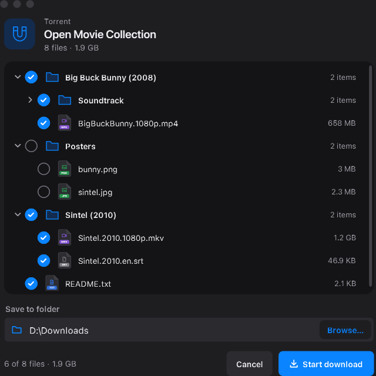

# AlwyIDM

A Windows download manager with pause and resume, browser integration, and torrent support. English and Arabic interfaces are available.

**[Download the latest Windows release](https://github.com/hishamalwy/AlwyIDM-Releases/releases/latest)** · [Browser extension](https://chromewebstore.google.com/detail/dbhagodffkcnbhalidkgnanifhbpakkk) · [Report a problem](https://github.com/hishamalwy/AlwyIDM-Releases/issues)

**Requirements:** Windows 10 version 2004 or later, or Windows 11, 64-bit.

> **Before you install:** AlwyIDM is not digitally signed. Windows may display a security warning. A download hosted on GitHub is not a guarantee of safety. Review the release notes and decide whether you trust the application before running it. Do not disable Windows security protections to try it.


## Start here

1. Open the [latest release](https://github.com/hishamalwy/AlwyIDM-Releases/releases/latest).
2. Choose the installer, `AlwyIDM-<version>-Setup.exe`, or the portable archive, `AlwyIDM-<version>-win-x64.zip`.
3. If using the portable archive, extract it before opening `AlwyIDM.exe`. If using the installer, review any Windows security warning before deciding whether to run it.
4. Add a download link in the app. For browser capture, see [Browser extension](#browser-extension).

**Updating?** Quit AlwyIDM first: right-click its notification-area icon and choose **Quit AlwyIDM**. Closing the main window alone keeps downloads running.

## Features

- Starts with 8 connections per file and adds more, up to 32, while it keeps getting faster
- Spreads connections across all of a site's servers and reopens any connection that slows down
- Writes straight into the final file, so there's no joining step at the end
- Pause and resume, even after a restart
- [Browser extension](https://chromewebstore.google.com/detail/dbhagodffkcnbhalidkgnanifhbpakkk) for Chrome, Edge and Brave (and Firefox), with a download button on videos
- Speed graph and per-connection speed while downloading
- Converts video and audio (MP4, HEVC, MP3, M4A, FLAC, WAV) without extra software
- Downloads torrents and magnet links: pick the files you want, pause and resume, and choose whether to keep sharing afterwards
- Lets you look inside a ZIP before downloading it and pick only the files you need
- Checks the file against the checksum when the site publishes one
- Records live streams, grabs all links from a page, and takes links from your phone over Wi-Fi
- Can start with Windows and wait in the notification area by the clock; closing the window keeps downloads running
- Scheduler, speed limits and an English or Arabic interface




### Browser extension

**Chrome, Edge or Brave:** [add AlwyIDM from the Chrome Web Store](https://chromewebstore.google.com/detail/dbhagodffkcnbhalidkgnanifhbpakkk). Install the app first; the extension connects to it on its own. After installing AlwyIDM, your browser usually offers to turn the extension on the next time it starts, and **Browser extension** in the app's sidebar opens the store page.

**Firefox:** go to `about:debugging#/runtime/this-firefox`, click **Load Temporary Add-on** and pick `manifest.json` in:

```
%LocalAppData%\Programs\AlwyIDM\firefox-extension
```

### Torrents

Paste a magnet link into **New download**, or use **Open a .torrent file**. Torrents are saved to `Downloads\Torrents` (you can pick another folder before starting). To have magnet links and .torrent files open in AlwyIDM when you click them, turn on **Open magnet links and .torrent files with AlwyIDM** in Settings. Windows may ask you to allow AlwyIDM through the firewall the first time a torrent starts; review the prompt and allow network access only if you intend to use peer-to-peer transfers and trust the app.


## Help test AlwyIDM

If you try it, report what worked and what failed in [Issues](https://github.com/hishamalwy/AlwyIDM-Releases/issues). Useful details:

- App version and Windows version.
- What you tried, what you expected, and what happened.
- Steps to reproduce the problem.
- Browser and extension version, if browser capture is involved.
- A screenshot or error message, with private information removed.

Do not include passwords, cookies, access tokens, private download links, or personal files. Use a public test file when reporting download problems. Only download or share content you have permission to access.

## About this repository

This repository distributes AlwyIDM releases, screenshots, and documentation. See [releases](https://github.com/hishamalwy/AlwyIDM-Releases/releases/latest) for the current version and changes, and [PRIVACY.md](PRIVACY.md) for the privacy information.
