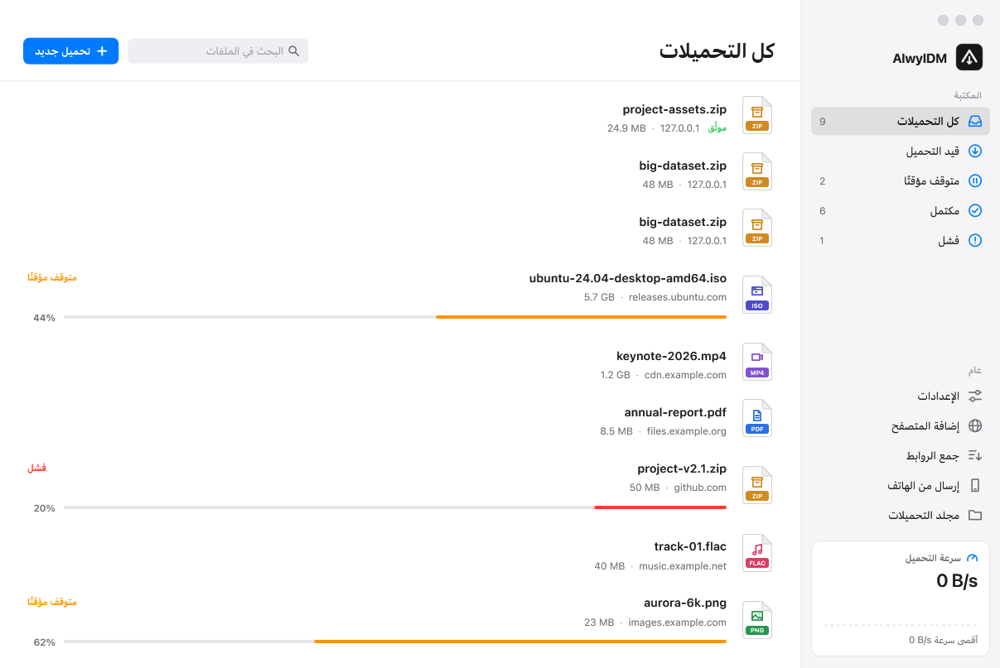
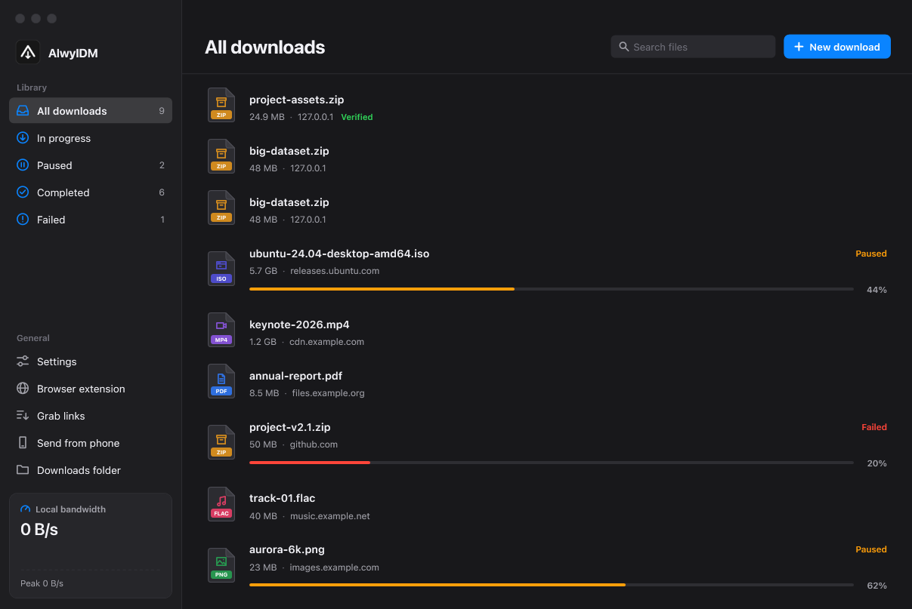
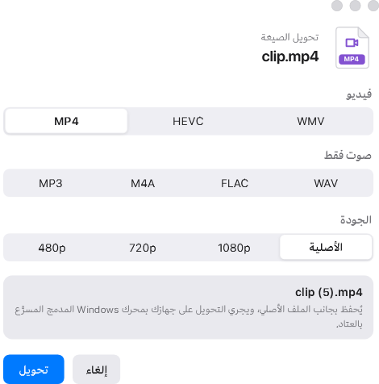

# AlwyIDM

مدير تحميلات سريع لنظام Windows، بتصميم هادئ على طريقة تطبيقات Apple، وبالعربية والإنجليزية.

  <a href="https://github.com/hishamalwy/AlwyIDM-Releases/releases/latest/download/AlwyIDM-0.5.0-Setup.exe"><b>⬇ تحميل AlwyIDM لنظام Windows</b></a>
  &nbsp;·&nbsp;
  <a href="https://github.com/hishamalwy/AlwyIDM-Releases/releases/latest">كل الإصدارات</a>

## المزايا

- **تحميل متعدد الاتصالات يتكيّف وحده:** يبدأ بثمانية اتصالات ويزيدها حتى 32 ما دامت الزيادة تُسرّع، ويوزّعها على كل خوادم الموقع، ويعيد فتح أي اتصال يتباطأ.
- **لا خطوة تجميع في النهاية:** تُكتب الأجزاء مباشرة في ملف واحد، والتحميل يُستأنف من حيث توقف.
- **متابعة حيّة:** رسم بياني للسرعة، وسرعة كل اتصال وحجمه.
- **إضافة للمتصفح** (Chrome وEdge وBrave وFirefox) تلتقط التحميلات وتضع زر تحميل فوق الفيديو.
- **تحويل الصيغ:** فيديو إلى MP4 وHEVC، وصوت إلى MP3 وM4A وFLAC، على جهازك ودون برامج إضافية.
- **فتح ملفات ZIP قبل تحميلها** وتحميل ما تختاره منها فقط.
- **التحقق التلقائي من سلامة الملف** إذا نشر الموقع بصمته.
- **تسجيل البث المباشر،** و**جمع روابط صفحة كاملة،** و**الإرسال من الهاتف** برمز QR، و**جدولة** التحميل.

## التثبيت

1. حمّل الملف `AlwyIDM-0.5.0-Setup.exe` من الرابط أعلاه وشغّله.
2. إذا ظهرت رسالة «Windows protected your PC» فاضغط **More info** ثم **Run anyway**. تظهر هذه الرسالة لأن البرنامج جديد وغير موقَّع رقميًا بعد.
3. بعد التثبيت يفتح البرنامج، ويرتبط بالمتصفح تلقائيًا دون أي إعداد.

### إضافة المتصفح

- **Chrome / Edge / Brave:** افتح صفحة الإضافات (`chrome://extensions`)، وفعّل **وضع المطوّر**، ثم اختر **Load unpacked** وحدّد المجلد
  `%LocalAppData%\Programs\AlwyIDM\chrome-extension`
- **Firefox:** افتح `about:debugging#/runtime/this-firefox` واختر **Load Temporary Add-on**، ثم حدّد ملف `manifest.json` من المجلد
  `%LocalAppData%\Programs\AlwyIDM\firefox-extension`

يمكنك أيضًا فتح المجلد مباشرة من البرنامج: **إضافة المتصفح** في الشريط الجانبي.

## المتطلبات

Windows 10 (الإصدار 2004 أو أحدث) أو Windows 11، بنواة 64 بت. لا يحتاج إلى تثبيت أي شيء آخر.

---

## English

**AlwyIDM** is a fast download manager for Windows with an Apple-style interface, in English and Arabic.

**[Download for Windows](https://github.com/hishamalwy/AlwyIDM-Releases/releases/latest/download/AlwyIDM-0.5.0-Setup.exe)** · [All releases](https://github.com/hishamalwy/AlwyIDM-Releases/releases/latest)

- Adaptive multi-connection downloads (8 → 32 connections), spread across every server behind the host, with slow connections reopened automatically
- Writes straight into one file, so there's no merge step; resumes where it stopped
- Live speed chart and per-connection speed
- Browser extension for Chrome, Edge, Brave and Firefox, with a download button over videos
- Format conversion (MP4, HEVC, MP3, M4A, FLAC…) on your PC with no extra software
- Browse a ZIP before downloading and fetch only the files you pick
- Automatic checksum verification, live stream recording, page link grabber, send-from-phone, scheduler

**Install:** run `AlwyIDM-0.5.0-Setup.exe`. If SmartScreen appears, choose **More info → Run anyway** (the app isn't code-signed yet). The browser connection is set up automatically. To add the extension, load the `chrome-extension` (or `firefox-extension`) folder from `%LocalAppData%\Programs\AlwyIDM`.

**Requires** Windows 10 (2004+) or Windows 11, 64-bit.

