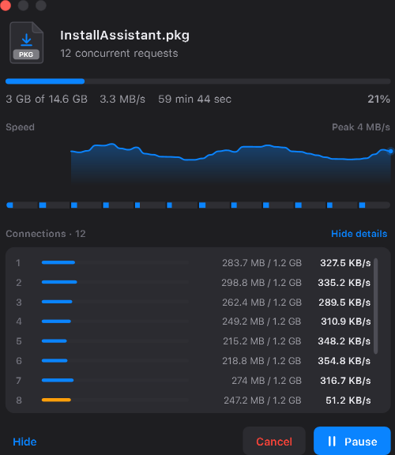

# AlwyIDM

A download manager for Windows. It splits files across many connections, resumes where it left off, catches downloads from your browser, and handles torrents.

[Download AlwyIDM for Windows](https://github.com/hishamalwy/AlwyIDM-Releases/releases/latest) (66 MB)


## Features

- Starts with 8 connections per file and adds more, up to 32, while it keeps getting faster
- Spreads connections across all of a site's servers and reopens any connection that slows down
- Writes straight into the final file, so there's no joining step at the end
- Pause and resume, even after a restart
- Browser extension for Chrome, Edge, Brave and Firefox, with a download button on videos
- Speed graph and per-connection speed while downloading
- Converts video and audio (MP4, HEVC, MP3, M4A, FLAC, WAV) without extra software
- Downloads torrents and magnet links: pick the files you want, pause and resume, and choose whether to keep sharing afterwards
- Lets you look inside a ZIP before downloading it and pick only the files you need
- Checks the file against the checksum when the site publishes one
- Records live streams, grabs all links from a page, and takes links from your phone over Wi-Fi
- Can start with Windows and wait in the notification area by the clock; closing the window keeps downloads running
- Scheduler, speed limits and an English or Arabic interface




## Install

1. Download `AlwyIDM-<version>-Setup.exe` from the [latest release](https://github.com/hishamalwy/AlwyIDM-Releases/releases/latest) and run it.
2. Windows may show "Windows protected your PC" because the app isn't code-signed yet. Click **More info**, then **Run anyway**.
3. AlwyIDM opens when setup finishes. It connects to your browser on its own.

To update later, quit AlwyIDM first: right-click its icon by the clock and choose **Quit AlwyIDM**.

If you'd rather not install anything, use the `win-x64.zip` file from the [releases page](https://github.com/hishamalwy/AlwyIDM-Releases/releases/latest) and run `AlwyIDM.exe`.

### Browser extension

Chrome, Edge or Brave: go to `chrome://extensions`, turn on Developer mode, click **Load unpacked** and pick:

```
%LocalAppData%\Programs\AlwyIDM\chrome-extension
```

Firefox: go to `about:debugging#/runtime/this-firefox`, click **Load Temporary Add-on** and pick `manifest.json` in:

```
%LocalAppData%\Programs\AlwyIDM\firefox-extension
```

You can also open the folder from the app with **Browser extension** in the sidebar.

### Torrents

Paste a magnet link into **New download**, or use **Open a .torrent file**. Torrents are saved to `Downloads\Torrents` (you can pick another folder before starting). To have magnet links and .torrent files open in AlwyIDM when you click them, turn on **Open magnet links and .torrent files with AlwyIDM** in Settings. Windows may ask you to allow AlwyIDM through the firewall the first time a torrent starts; allow it so other peers can connect.

## Requirements

Windows 10 version 2004 or later, or Windows 11 (64-bit).


